

<a href="https://portos-azure.vercel.app/"></a>
<a href="https://github.com/nishant25bce10660-cell"></a>

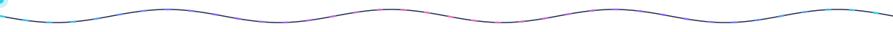

<table align="center">
<tr>
<td width="55%" valign="middle"></td>
<td width="45%" valign="middle"></td>
</tr>
</table>

<b>About me</b> <i>(click to collapse)</i>

- I’m a **B.Tech CSE student** who loves building things for the web and exploring machine learning.
- I’m currently building **[PORT-OS](https://portos-azure.vercel.app/)**, a portfolio that behaves like an operating system.
- I’m always happy to collaborate on open-source and learning projects.

<b>Quick links</b> <i>(click to expand)</i>

- Portfolio: [portos-azure.vercel.app/](https://portos-azure.vercel.app/)
- GitHub: [@nishant25bce10660-cell](https://github.com/nishant25bce10660-cell)
<!-- Add LinkedIn / email / Instagram here once you want them on your profile -->

## Tech stack

## Featured projects
<table><tr><td align="center" width="33%"><a href="https://github.com/nishant25bce10660-cell/PORT-OS"></a></td><td align="center" width="33%"><a href="https://github.com/nishant25bce10660-cell/SMS_SPAM_DETECTION"></a></td><td align="center" width="33%"><a href="https://github.com/nishant25bce10660-cell/digital-literacy-project"></a></td></tr></table>

## Currently exploring

## Contribution snake
Every green square is a snack for the snake.

<picture>
  <source media="(prefers-color-scheme: dark)" srcset="https://raw.githubusercontent.com/nishant25bce10660-cell/nishant25bce10660-cell/output/github-snake-dark.svg"/>
  <source media="(prefers-color-scheme: light)" srcset="https://raw.githubusercontent.com/nishant25bce10660-cell/nishant25bce10660-cell/output/github-snake.svg"/>
  
</picture>

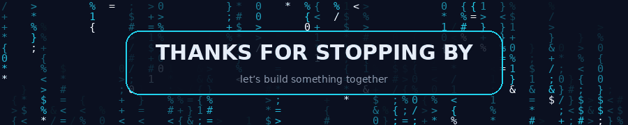

